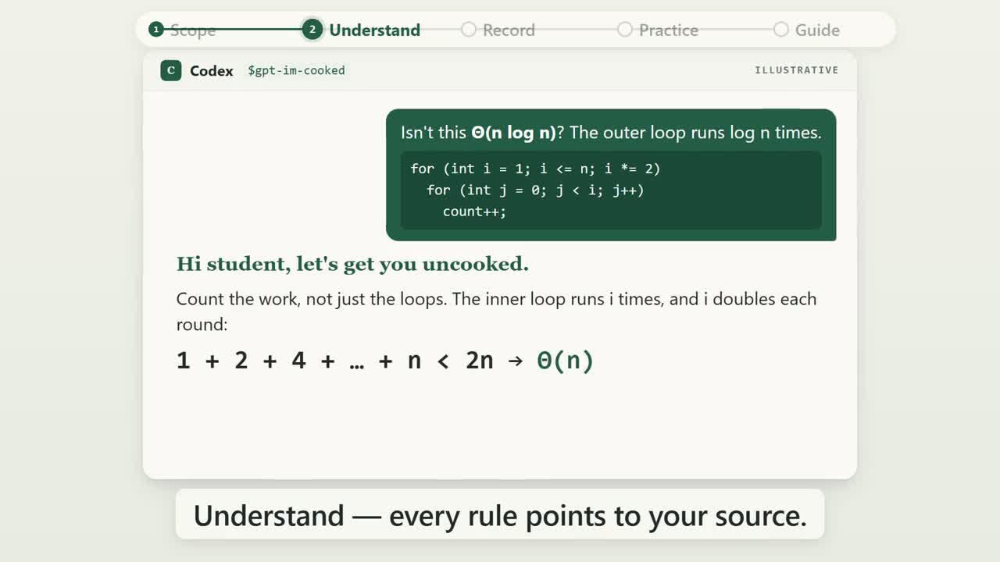
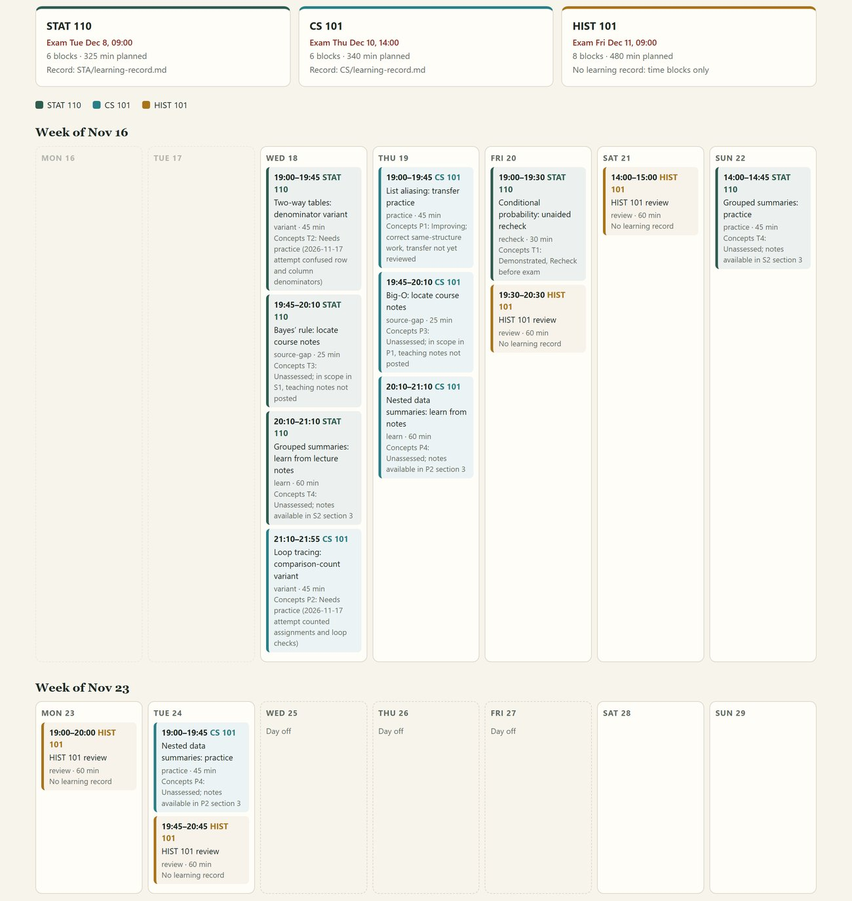
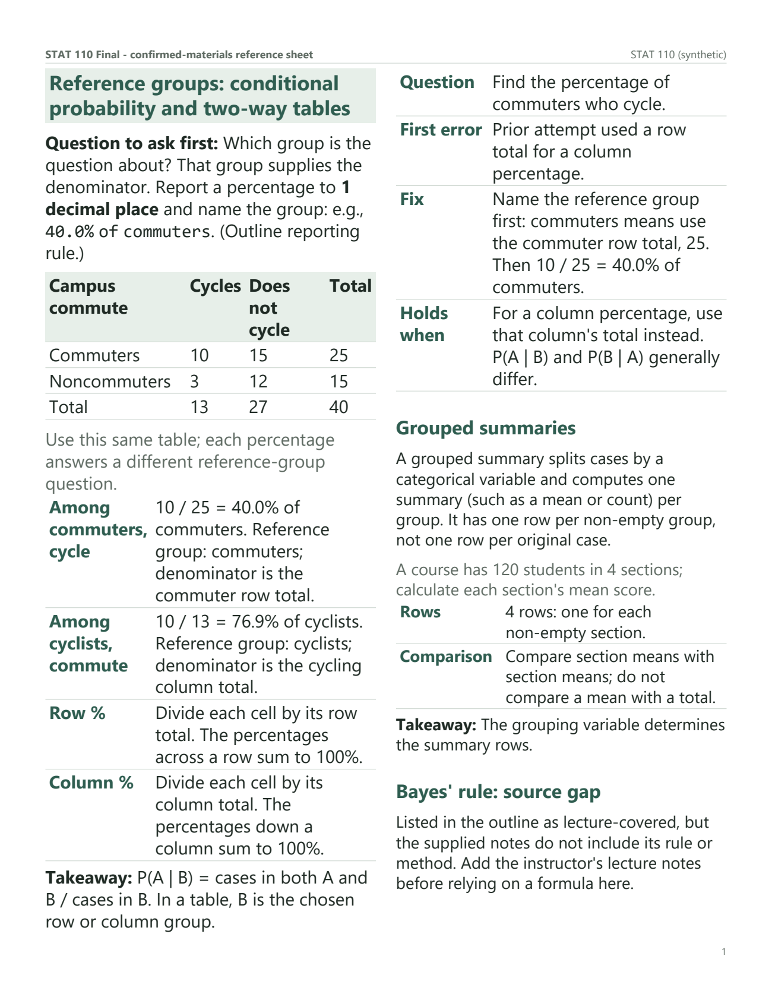
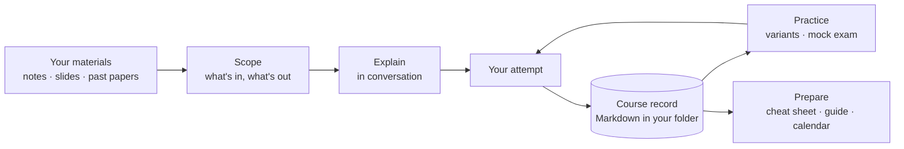

<p align="center"></p>

<p align="center">
  <a href="https://github.com/JerNB/gpt-im-cooked/releases/latest"></a>
  
  
</p>

<p align="center">
  <a href="https://jernb.github.io/gpt-im-cooked/demo.html"><strong>Try the mock exam</strong></a> ·
  <a href="#quick-start"><strong>Install</strong></a> ·
  <a href="#what-it-makes">Examples</a> ·
  <a href="CHANGELOG.md">Changelog</a> ·
  <a href="VALIDATION.md">Testing &amp; limits</a>
</p>

**GPT, I'm Cooked** is a study skill for Codex:
- Bring your lecture notes and a past paper, and work through the concept that lost you.
- Turn the mistakes you made into your next practice exam, review guide or exam cheat sheet.

Everything it teaches comes from the materials you supply, and your progress is kept as plain Markdown in your own folder. It is built for college and graduate courses taught in English, including for international students at US universities.

## Watch one mistake become practice

[](https://jernb.github.io/gpt-im-cooked/assets/showcase/preview-720p-en.mp4)

**[▶ Play (60 s, English)](https://jernb.github.io/gpt-im-cooked/assets/showcase/preview-720p-en.mp4)** · [Chinese portrait edition](https://jernb.github.io/gpt-im-cooked/assets/showcase/preview-720p-zh.mp4)

The outer loop doubles `i` and the inner loop runs `i` times, so the work is 1 + 2 + 4 + … + n < 2n: Θ(n), not Θ(n log n). Change the inner bound to `n` and the answer changes. That change becomes the next practice question.

*Chat scenes are illustrative and the learning record is synthetic. [Music](docs/assets/showcase/BGM-LICENSE.md) · [Sound credits](docs/assets/showcase/FREESOUND-CREDITS.md)*

## What you can do

| You want to… | Ask, for example | You get |
| --- | --- | --- |
| **Understand** a lecture | "Walk me through the first worked example in these notes, then give me one to try." | A plain-language explanation tied to your slides and a question to try on your own. Gaps in your notes are flagged instead of filled in. |
| **Practise** a weak spot | "I keep mixing up row and column percentages. Give me a new one." | A variant that changes the setting or a condition, not just the numbers. For a full rehearsal, an HTML mock exam with a separate answer key. |
| **Pick up** where you left off | "What's left before my midterm?" | Your mistakes, the help you received and your real progress, read back from your course record. "Mastered" only after a later, unaided transfer question. |
| **Prepare** for finals | "Make me a cheat sheet. One sheet, both sides." · "Plan my STA and CS finals." | A cheat sheet or review guide as a PDF sized to your exam rules, and a study calendar across courses as `.ics` plus a printable page. |

## What it makes

These are real outputs:
- The calendar and the cheat sheet were produced by the released skill in test sessions on a synthetic course.
- The mock exam and the review guide come from the study sessions that inspired the project.

<table>
<tr>
<td width="50%" valign="top">
<a href="https://jernb.github.io/gpt-im-cooked/examples/sta199/practice/STA199_Mock_Practice_B.html"></a>
<br><strong>Mock exam</strong> · STA199<br>
A 32-question practice paper built around a student's recorded mistakes, with a separate key. <a href="https://jernb.github.io/gpt-im-cooked/examples/sta199/practice/STA199_Mock_Practice_B.html">Try it</a> · <a href="docs/examples/sta199/learning-record-english.md">Learning record</a>
</td>
<td width="50%" valign="top">
<a href="docs/examples/cs201/guide.pdf"></a>
<br><strong>Review guide</strong> · CS201<br>
A six-page PDF that turns questions about object references into diagrams and code traces. <a href="docs/examples/cs201/guide.pdf">Read the PDF</a> · <a href="https://jernb.github.io/gpt-im-cooked/examples/cs201/">Browse the case</a>
</td>
</tr>
<tr>
<td width="50%" valign="top">
<a href="docs/assets/showcase/study-calendar.jpg"></a>
<br><strong>Study calendar</strong> · three courses<br>
Every block says which record entry put it there, for example "Needs practice (attempt confused row and column denominators)". Days off stay empty.
</td>
<td width="50%" valign="top">
<a href="docs/assets/showcase/cheat-sheet.png"></a>
<br><strong>Exam cheat sheet</strong> · STAT 110<br>
A worked table instead of abstract rules, and the student's own mistake turned into a short fix. A topic missing from the notes is flagged rather than invented.
</td>
</tr>
</table>

Interactive concept pages are optional. Here is one for grouped `mutate()` vs `summarize()`: [open the example](examples/grouped-transformations.html) · [screenshot](docs/assets/showcase/concept-page.png).

## How it works



- **Grounded in your course.** Every rule it teaches points to a file you supplied. When your notes don't cover something, it says so and asks. It does not fill the gap from the web.
- **Your attempt first.** Practice sets and mock exams keep their answer keys in separate files, so you can try before you look.
- **Honest progress.** One correct answer is not mastery. A topic counts as *Demonstrated* only after a reviewed transfer question in a new setting, and a same-day success gets a later recheck.
- **Local files.** There is no server and no account. Records, sheets and calendars are ordinary files in your workspace, and nothing is written to your calendar app without your yes.

## Quick start

1. **[Download the skill (v2.0.2)](docs/downloads/gpt-im-cooked-skill-v2.0.2.zip)**. Extract the whole `gpt-im-cooked` folder into `~/.codex/skills/`, or into your `$CODEX_HOME/skills/`.
2. Restart Codex or refresh the skill list. Open a new chat in the folder that has your course files.
3. Start with one request:

```text
Use $gpt-im-cooked. Here are my CS201 notes and last year's midterm.
Walk me through the loop-analysis question I got wrong, then give me a similar one.
```

More starting points:

```text
My STA199 final is in two weeks. Make me a one-sheet, two-sided cheat sheet.
```

```text
Plan my STA and CS finals: weekday evenings 7-10pm, weekends 2-6pm, nothing over Thanksgiving.
```

Prefer the plugin, which adds a getting-started guide? [Download the plugin](docs/downloads/gpt-im-cooked-plugin-v2.0.2.zip) and follow the [installation guide](docs/INSTALLATION.md).

The bundled helpers need Python 3.10 or later: PDF sheets, calendar files and one-step record saves. Without Python the tutor still works, and it tells you which file it could not produce. Tutoring is in English by default; ask if you want another language.

## What's new in 2.0.2

- **Study calendar across courses.** Tasks come from each course's record and fit into the study windows you give once. Export an `.ics` file or print the page.
- **Exam cheat sheets as real PDFs, with nothing to install.** You answer one question about your exam allowance, then get a draft. Spare space becomes larger type, and your revision preferences are remembered.
- **Leaner revisions.** In a small old-vs-new comparison, making a sheet again in a fresh session used about half the tokens.

[Full release notes](CHANGELOG.md) · [All releases](https://github.com/JerNB/gpt-im-cooked/releases)

## Evidence and limits

This project reports what it measured and what it didn't.
- **What was tested.** Behaviour has been checked in exploratory runs on synthetic courses, with a scripted student, one model at a time and a few sessions per version. Examples: the [old-vs-new sheet comparison](tests/reports/2026-11-19-sheet-compare/REPORT.md) and the [calendar pilot](tests/reports/2026-11-18-feature-pilot/REPORT.md).
- **What that shows.** These runs are evidence that the workflow behaves as described, not that it improves grades.
- **What was not measured.** Learning gains, studies with real students, other models and paper printing.

Details are in [VALIDATION.md](VALIDATION.md).

The skill does not predict your exam or promise a grade. A cheat sheet is only for exams that allow one, so check your instructor's rules.

<details>
<summary><strong>For contributors: repository layout and checks</strong></summary>

| Path | What it is |
| --- | --- |
| [`plugins/gpt-im-cooked/skills/gpt-im-cooked/SKILL.md`](plugins/gpt-im-cooked/skills/gpt-im-cooked/SKILL.md) | The skill itself; `references/` are loaded on demand |
| `plugins/gpt-im-cooked/skills/gpt-im-cooked/scripts/` | Standard-library helpers: record saves, mock-exam and sheet renderers, the PDF writer and the calendar planner |
| `plugins/gpt-im-cooked/skills/gpt-im-cooked-start/` | The plugin's getting-started entry |
| `docs/` | Project site, demo exam, examples and versioned downloads |
| `tests/` | Regression checks and dated evidence reports |

```bash
python tests/validate_package.py    # package structure, links, metadata
python tests/check_sheet_render.py  # cheat-sheet renderer and PDF writer
python tests/check_study_plan.py    # calendar planner and exports
python tests/check_state_io.py      # record saves
python scripts/build_packages.py    # rebuild the release ZIPs
```

Earlier release notes and test reports remain in [CHANGELOG.md](CHANGELOG.md) and `tests/reports/`.

</details>
