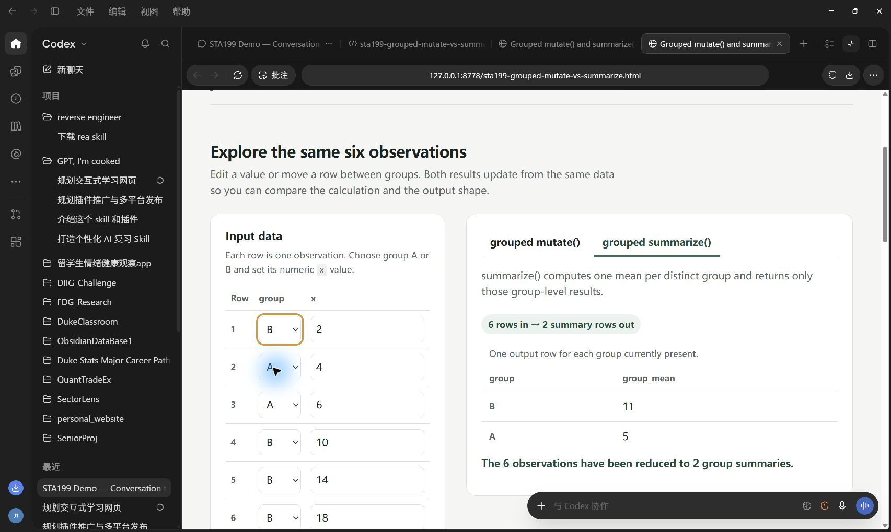
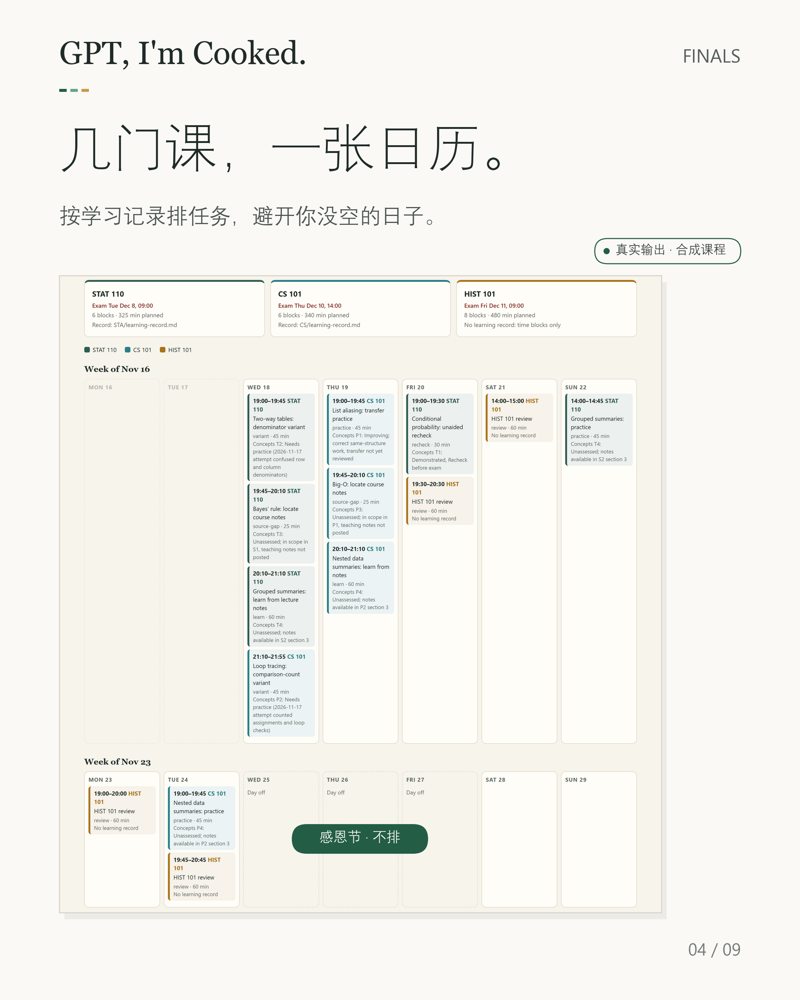
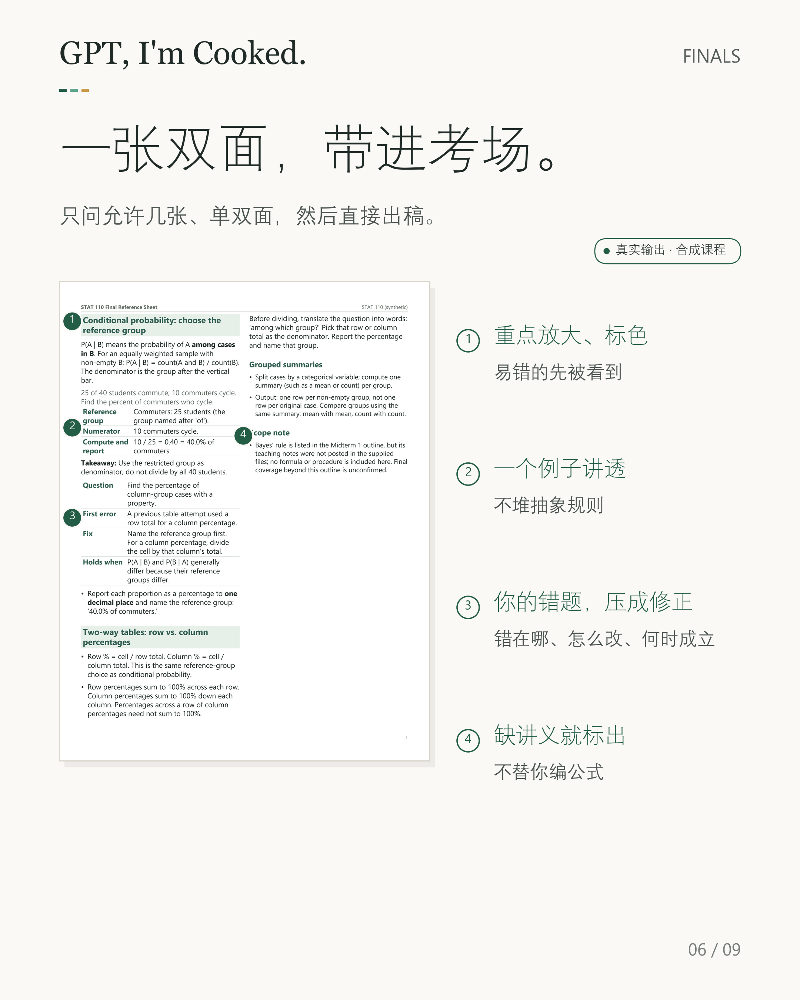

Bring your lecture notes to Codex. Work through a tricky concept, try a question on your own, and use the mistakes you made to shape your next practice exam.

## Watch a minute of review

**[Play in English · 60 seconds](media/showcase/preview-720p-en.mp4)** · **[Chinese portrait edition · 60 seconds](media/showcase/preview-720p-zh.mp4)**

The film follows one CS201 mistake. An outer loop doubles its index; the inner loop runs *i* times. Counting the work gives 1 + 2 + 4 + … + n, which is less than 2n. Now change the inner bound to *n*: does the same answer still hold? The walkthrough shows how that change becomes a fresh practice question. The chat scenes are illustrative and the learning record is synthetic. [Music](docs/assets/showcase/BGM-LICENSE.md) · [Sound credits](docs/assets/showcase/FREESOUND-CREDITS.md)

## Take the demo exam

**[Try the mock exam ↗](https://jernb.github.io/gpt-im-cooked/demo.html)** &nbsp; · &nbsp; **[Install the skill](#quick-start)**

*Inside the demo* · Try eight questions from a fictional statistics course. Mark a question to revisit, record your reasoning, then export your attempt for tutor feedback. The [answer key](docs/answer-key.html) opens separately.

## What you can do

| When you want to… | How the skill helps |
| --- | --- |
| Understand a lecture | Bring a slide, a reading, or the line of code that lost you. Ask for a worked example or an interactive concept page. The tutor flags gaps in your materials. |
| Practise one weak spot | Ask for a hint, explain your reasoning, then try the idea in a new setting. For a full rehearsal, generate an HTML mock exam with course-wide coverage and separate solutions. |
| Pick up where you left off | The tutor keeps meaningful mistakes, help received, and improvements in a course record in your workspace. Give a new chat access to that record to resume or recheck a topic. |
| Prepare for finals | Turn your weak spots into a PDF review guide or a reference sheet sized to your exam allowance. Fit tasks from several courses into your available study windows and export a printable calendar or an ICS file. |

## Follow a mistake through the workflow

1. **Predict the output.** In the [grouped transformations exercise](examples/grouped-transformations.html), consider what happens to the row count when you compute a mean within each group. A grouped summary and a new column can contain the same means while producing different tables.
2. **Ask for the smallest useful hint.** Try “Show me what happens to the first group, then let me finish the second.” Your first attempt and the help you received give the tutor different evidence.
3. **Try it again with a change.** Ask for a new dataset and decide which operation preserves the rows. When you return to the course record, the tutor can distinguish a corrected answer from a later independent attempt.

## Plan finals across courses

The two posters below are from the Chinese finals campaign. Open either image to inspect the example at full size.

**A calendar built from your records.** Give Codex your exam dates, available study windows, days off and daily time limit. Each study block points back to the evidence that put it on the calendar. Import the ICS file into your calendar app or print the HTML schedule.

> I have statistics on Tuesday and CS on Friday. Keep Sunday free. Use my two course records to plan the remaining evenings.

**A reference sheet that fits the exam rules.** Specify the number of sheets and permitted sides. The tutor can condense the examples you still mix up into a PDF, then revise the part you point out. For an exam that disallows notes, the same material can serve as a study guide beforehand.

> One double-sided sheet is allowed. Keep the join examples, shorten the definitions, and use any spare space for larger type.

## From actual study sessions

### STA199 · A practice midterm

A grouped-data row-count mistake and a join that duplicated rows became priorities for the next round of practice. [Try the 32-question paper](https://jernb.github.io/gpt-im-cooked/examples/sta199/practice/STA199_Mock_Practice_B.html) · [See the learning record](docs/examples/sta199/learning-record-english.md)

### CS201 · A six-page review guide

Questions about which objects two variables refer to became diagrams and code traces the student could work through on paper. [Read the original PDF](docs/examples/cs201/guide.pdf) · [Browse the case](https://jernb.github.io/gpt-im-cooked/examples/cs201/)

These student artifacts come from the study sessions that inspired the packaged skill.

## Quick start

1. [Download the standalone skill](docs/downloads/gpt-im-cooked-skill-v2.0.2.zip). Extract the whole `gpt-im-cooked` folder into `~/.codex/skills/` (or your configured `$CODEX_HOME/skills/`).
2. Refresh the skill list or restart Codex, then open a new chat and attach one course file.
3. Try this with a lecture you are reviewing:

   > Use $gpt-im-cooked with these lecture notes. Walk me through the first worked example, then give me a similar question to try on my own.

Tutoring defaults to English. You can ask for another language. For the plugin with its getting-started guide, see [installation options](docs/INSTALLATION.md).

[More examples](https://jernb.github.io/gpt-im-cooked/examples/) · [Testing and limitations](VALIDATION.md) · [Release history](CHANGELOG.md)
